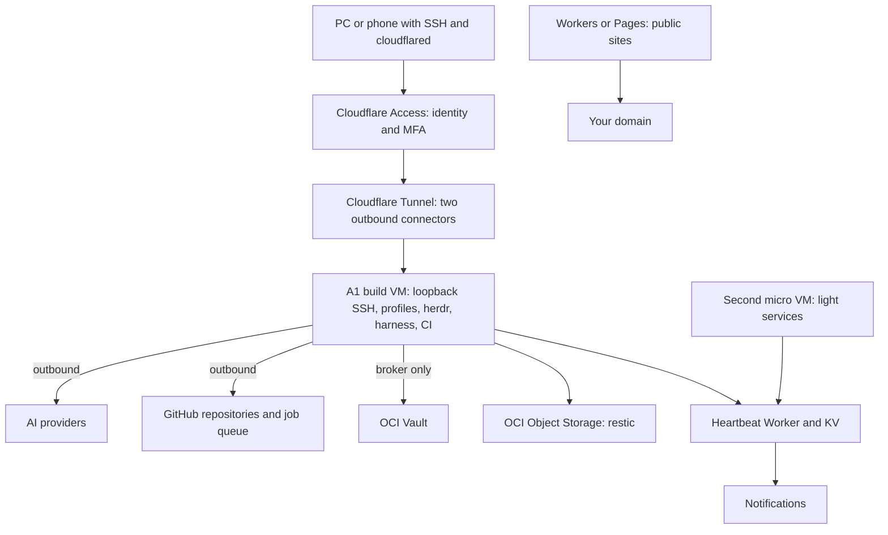

# 00 — Platform overview

Build a small, persistent workspace for coding agents: an ARM Linux host in Oracle Cloud Infrastructure (OCI), separate Linux profiles, terminal sessions reachable through Cloudflare Access, CI capacity, and encrypted backups. AI engines and accounts are configurable; bring your own subscriptions and comply with each provider's terms.

Both tunnel connectors run on the build VM in this baseline. This protects against a connector process failure; it does not survive VM failure. Both must reach the same origin. With zero OCI ingress, a connector on a micro VM cannot reach the build VM over the VCN. The micro VMs use their own tunnels if remote access is needed. Cross-host redundancy needs a separately reviewed routing design.

Follow chapters in numerical order. Chapters 06 (harness installation), 07 (AI engines), and 09 (messaging) are coming separately. Until they exist and their checks pass, infrastructure setup alone does not provide safe agent execution or secret brokering. This guide writes configuration; it is not an automated cloud deployment.

Use Always Free eligible OCI resources and Cloudflare Free plans within their allowances. Domain registration, AI subscriptions, extra compute and overages remain your responsibility. Budgets send alerts; they do not stop spending. See [the dated allowance ledger](11-free-tier-budget.md) before creating anything. A1 capacity and availability are not guaranteed. Keep recoverable backups outside a VM that can be reclaimed.

Success means: authenticated SSH works from a second device; anonymous access fails; VMs have no OCI ingress rules; profiles cannot read each other's homes; PR jobs cannot read credentials; an alert arrives when a heartbeat stops; and a restore reproduces a known file.
