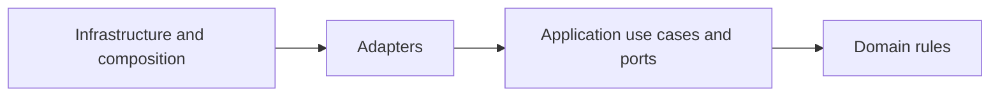

# Clean architecture

Keep stable business decisions independent from delivery frameworks and vendors. For a tiny script, use the same dependency discipline without creating empty layers.

| Boundary | Responsibility | Must not depend on |
|---|---|---|
| Domain | Entities, value rules, typed business errors | SDKs, I/O, environment variables, frameworks |
| Application | One use case per action; interfaces for external capabilities | Concrete storage, HTTP types, vendor clients |
| Adapters | Map HTTP/CLI input and implement application ports | Business policy hidden inside transport code |
| Infrastructure | Load configuration, construct clients, wire adapters and start the program | Business decisions that belong in the domain |

The application owns a port such as `DocumentStore` or `ModelClient`. A persistence or AI adapter implements it. The composition root selects implementations; no use case imports an OCI, Cloudflare or AI SDK. Pass time, IDs and randomness through ports when behavior depends on them. Keep prompts and provider options versioned beside their adapter.

For example, `PublishDocument` loads a document through `DocumentStore`, asks its domain model whether publication is allowed, and saves the new state. Its HTTP adapter validates the request shape and maps typed errors to responses. A Worker binding enters through infrastructure, never as a global in the use case.

Test domain rules with ordinary values and application flows with in-memory implementations. Test adapters with realistic local/test services. Keep a small set of end-to-end acceptance paths. A test that starts a database to exercise a pure business rule is a reason to revisit the boundary.

Enforce imports with dependency-cruiser or ESLint boundaries for TypeScript, or import-linter for Python. Configure explicit allowed dependencies, including sibling application modules, and reject cycles and outer-layer imports. Add the check to the fast CI gate. Prove enforcement once with a temporary deliberate violation, then remove it. Never treat a folder diagram alone as enforcement.
